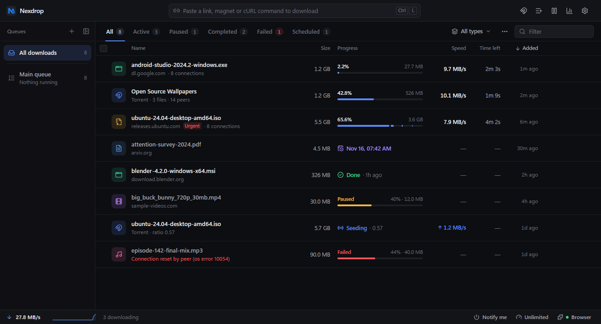
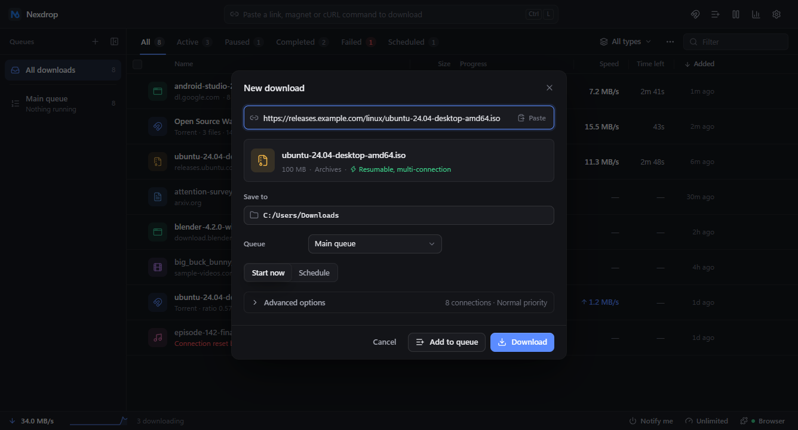
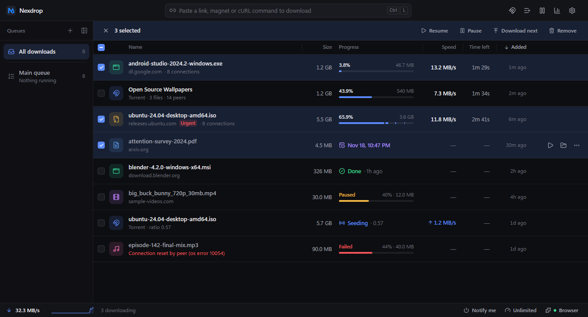
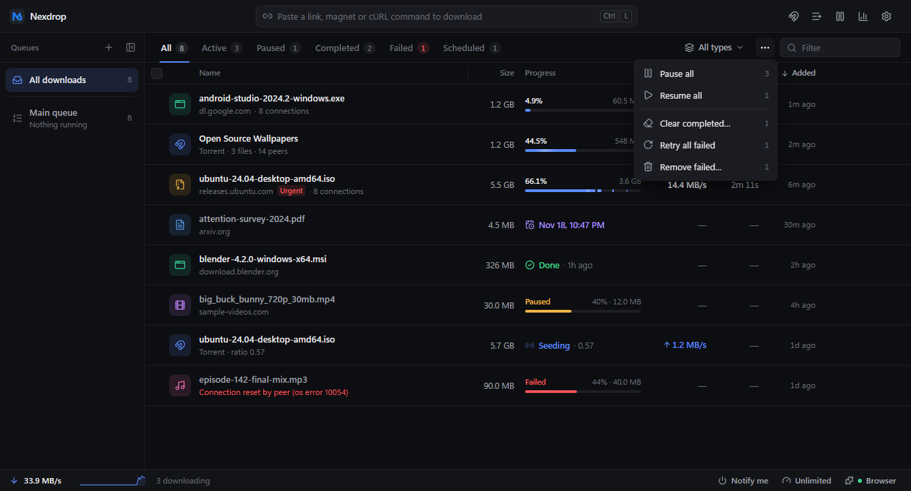
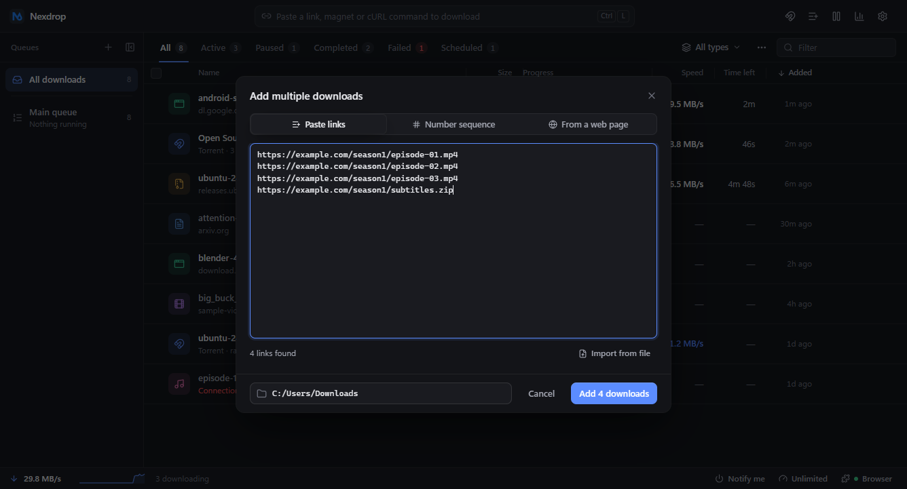
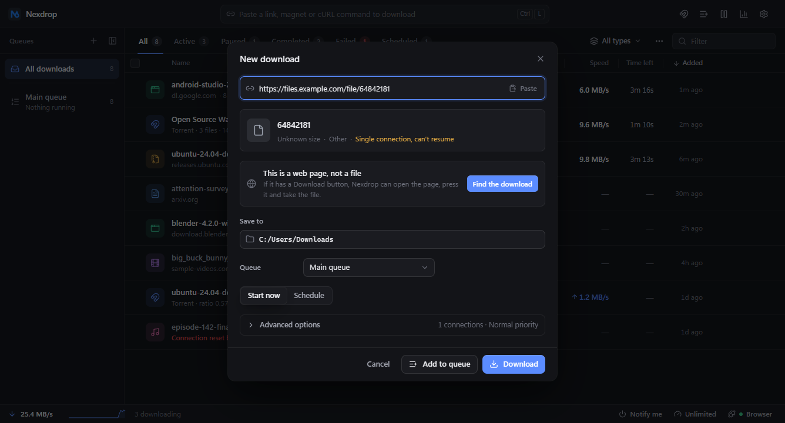
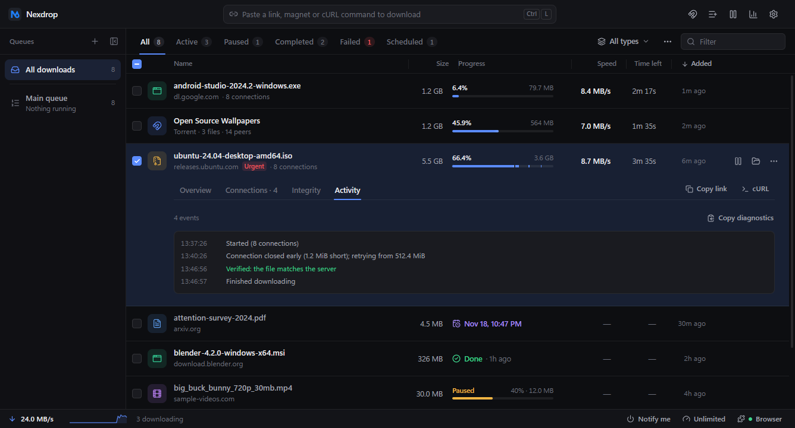
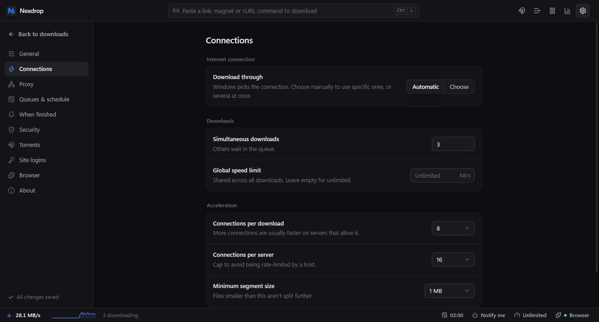
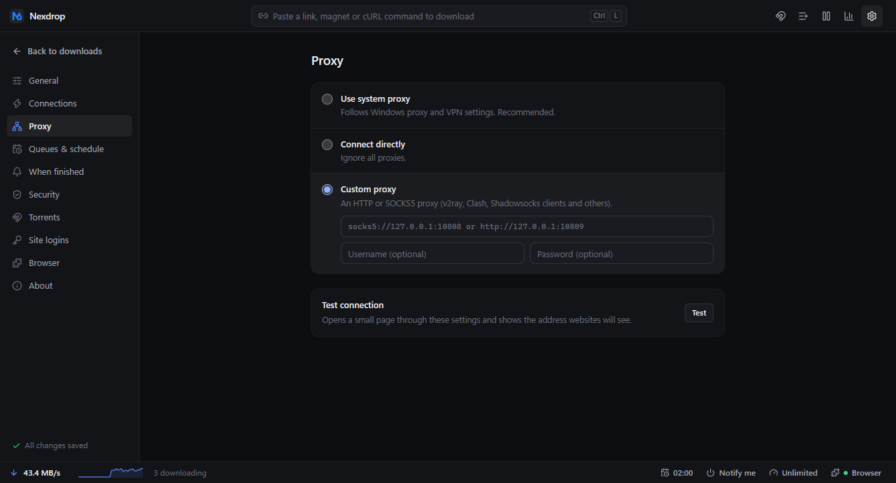

# Nexdrop

**A fast, safe download manager for Windows.** It speeds up your downloads, keeps them organised in queues, grabs files from your browser, handles streaming video and torrents, and stays out of your way.



> **Contents**
> 1. [For everyone: what Nexdrop does and how to use it](#part-1--for-everyone)
> 2. [How it works: the technical explanation](#part-2--how-it-works-technical)
> 3. [Getting started and building it yourself](#part-3--getting-started-and-building-it-yourself)

---

# Part 1 · For everyone

You don't need to know anything about programming for this part.

## What is Nexdrop?

When you download a file with your browser, it usually uses one connection to the website, and if your internet drops, the download often has to start over. A download manager does it better:

- It opens **several connections at once**, which can make big downloads much faster.
- It **remembers where it stopped**, so a download continues after you pause it, close the app, restart your computer or lose your internet.
- It keeps your downloads **in order**, in queues you control, and can start them at night.
- It **checks the file is intact** when it finishes.

Nexdrop does all of that with a clean, simple window. It also connects to **Chrome, Edge, Brave and Firefox**, so when you click a download in your browser, Nexdrop takes it over automatically.

## Get it

1. Open the **[Releases page](https://github.com/AMIRSRAD/Nexdrop/releases/latest)** and download **`Nexdrop_…_x64-setup.exe`**.
2. Double-click it. It installs just for you, and it doesn't need administrator rights.
3. Nexdrop starts, and offers to connect your browsers. Follow the steps on screen (about a minute).

**About the blue "Windows protected your PC" box.** Windows shows this for any installer from a small, new publisher. Nexdrop's installer isn't "code-signed" yet, which is a paid certificate. Click **More info → Run anyway**. The installer is built from the source code in this repository, and the app updates are digitally signed.

**Updates.** Nexdrop tells you when a new version is out (Settings → About) and installs it when you say so.

*macOS and Linux:* test builds exist (`.dmg`, `.AppImage`, `.deb`, built automatically from this code) but they haven't been tried on real computers yet, and some parts that depend on Windows (starting with Windows, finding your browsers) aren't there. Treat them as previews.

## Your first download

Copy a download link and press **Ctrl+N**, or just paste it into the bar at the top of the window. Nexdrop looks the file up and shows its name and size:



- **Download** starts it now.
- **Add to queue** puts it in line without starting yet (handy when you're adding several).
- **Schedule** starts it later, for example at 2 a.m.
- **Advanced options** has the number of connections, speed limit and more. The defaults are good.

The file goes to your Downloads folder, sorted into folders such as Videos, Compressed and Programs (you can change that in Settings).

## What you can do

### See and control everything in one list

Every download is in one clean list: what's running, what's waiting, what's finished or failed. Hover a row for pause, open and show-in-folder buttons, or right-click it for more.

It works like the file list on your computer: **click** to select, **Ctrl+click** to add, **drag a box** over rows to select several, and **drag the column edges** to resize them. Double-click a finished download to open it, or a running one to see its details.



With two or more selected, a bar appears to pause, resume, remove or **Download next**. The **⋯** menu next to the filters acts on everything at once:



### Add lots of links at once

Paste a list of links, a numbered series (`part-01.rar` to `part-20.rar`), or let Nexdrop scan a web page. They appear in your list right away and are checked in the background, so adding 20 files doesn't make you wait.



### Web pages with a "Download" button

Some file sites don't give you a file link, but a page where you have to press a button (often after a countdown). Paste that link and Nexdrop notices it's a web page. Press **Find the download** and it opens the page by itself, presses the button for you, and takes the file. It only does this when you press the button. If the page needs you to do something (a check, for example), a window opens so you can finish it.



### Queues and schedules

A queue is a waiting line. Make as many as you like: one for big files at night, one for everything else. Each can have its own days and hours, its own limit on how many download at once, its own speed limit, and an action when it's done (quit Nexdrop, sleep, shut down…). Your queues are always shown on the left.

- Right-click a download: **Download next**, **Move up / down**, **Move to the end**, or **Download now** (starts it even if the queue is full).
- Drag downloads onto a queue to move them.
- Waiting downloads say **Next up** or **#3 in line**.


### Your browser, connected

Install once, and clicking a download link in your browser sends it to Nexdrop, with the cookies and login the website needs. A small **Download** button shows over videos you're watching, and right-clicking offers **Download all N files on this page** or **Download N selected links**. Hold **Alt** on a link to let the browser handle that one itself.


### Streaming video

Paste a `.m3u8` or `.mpd` video link and pick a quality. Nexdrop downloads the pieces in parallel and joins them into a normal `.mp4` you can play anywhere.


### Looks inside a download

Double-click a running download to see its connections, its checksum, and an **Activity** log of what happened to it (started, retried, verified). If something ever goes wrong, **Copy diagnostics** gives you text to paste into a bug report.



### Several internet connections, proxies and VPNs

If your computer has more than one internet connection (Ethernet and Wi-Fi, for example), you can let Nexdrop use one of them or **several at once**:



Nexdrop follows your Windows proxy or VPN by default. You can also set a custom **HTTP or SOCKS5 proxy** (with a username and password), and a **Test connection** button shows you which address websites will see:



### Also included

- **Torrents and magnet links**, with a choice of which files to download.
- **Safe downloads:** Nexdrop checks big files against the server before it keeps them, and re-downloads any part that came through wrong. Files are marked as downloaded from the internet, and you can have Windows Defender scan them.
- **Expired link?** Right-click → **Refresh link**, paste the new one, and the download continues where it stopped.
- **The same file again?** Nexdrop warns about duplicates and asks whether to keep both or replace.
- **A tray icon** shows live status. Closing the window keeps downloads running; **Exit** in the tray menu really quits. Nexdrop can start with Windows.
- **Quiet:** it uses almost no processor while idle, and about 135 MB of memory when it's sitting in the tray.
- **Saved logins** for sites, stored encrypted, and **clipboard watching** that offers to download links you copy (both optional).

## Keyboard shortcuts

| | |
|---|---|
| **Ctrl+N** | New download |
| **Ctrl+B** | Add multiple links |
| **Ctrl+T** | Add a torrent |
| **Ctrl+A** | Select all |
| **Space** | Pause / resume the selected download |
| **Enter** | Open a finished download; show details of a running one |
| **Delete** | Remove the selected downloads |
| **Alt+↑ / ↓ / Home / End** | Move a waiting download in its queue |
| **Ctrl+F** | Search the list |
| **Ctrl+,** | Settings |
| **Esc** | Close details or clear the selection |

## Questions

**Is it free?** Yes. The source code is here to read; see [LICENSE](LICENSE) for what you may and may not do with it.

**Is it safe?** The program is open to inspection, the installer is built from this code, and updates are digitally signed, so a fake update can't be installed. Nexdrop only talks to the sites you download from, GitHub (to look for updates), your own browser extension on your own computer, and, only when you press the proxy **Test connection** button, a Cloudflare address that reports your IP.

**Where do my files go?** Your Downloads folder by default, in subfolders by type. Change it in Settings → General.

**How do I uninstall it?** Windows Settings → Apps → Nexdrop. Your download list is kept unless you delete the folder `%LOCALAPPDATA%\Nexdrop`.

**A download failed or a file is damaged.** Open the download's **Activity** tab and use **Copy diagnostics**, then open an issue on this page and paste it.

---

# Part 2 · How it works (technical)

This part is for developers and curious users. Measurements are in [`ENGINE_REPORT.md`](ENGINE_REPORT.md), and the status of every feature is in [`ROADMAP.md`](ROADMAP.md).

## The big picture

```
 browser extension ──HTTP (127.0.0.1:18888, extension origins only)──┐
                                                                     ▼
 React 19 UI  ◀──Tauri commands + events──▶  Rust backend (Tokio)
 (Vite, Tailwind 4)                           ├─ DownloadManager: queues, scheduler, state in SQLite
                                              ├─ DownloadEngine: ranged HTTP downloads (reqwest)
                                              ├─ stream/: HLS + DASH downloader and fMP4 muxer
                                              ├─ torrent: librqbit
                                              ├─ resolver: hidden WebView2 page for "Find the download"
                                              └─ tray, notifications, single instance, updater
```

- **Tauri 2** gives a small native shell: Rust for everything heavy, the system WebView2 for the interface. There is no bundled browser, so the installer is about 9 MB.
- The UI never talks to the network. It calls Rust commands (`src-tauri/src/commands`) and listens for events (progress, status changes, queue changes). Progress events are batched once per animation frame, so a dozen active downloads cost one React render.
- **State** lives in one SQLite file (`rusqlite`): downloads, segments, queues, settings, per-download activity logs. Cookies and passwords are encrypted with Windows DPAPI before they're stored.

## The download engine (`src-tauri/src/engine/downloader.rs`)

- **One sparse, preallocated file per download**, written at the right offsets by a dedicated disk thread (writes are coalesced to about 512 KiB or 250 ms). Finishing is an atomic rename; there are no segment files and no merge pass.
- **Ranges and dynamic segmentation.** The file is cut into ranges; a connection that runs out of work steals the upper half of the biggest range still running. Connections ramp up (up to 16 immediately, then more) and back off on 429/503.
- **Exact resume.** A done-range map (`name.nexpart.map`) is saved atomically and `fsync`ed. On resume, `If-Range` (strong ETag, else `Last-Modified`) detects a changed file.
- **Reliability.** Per-range retries with exponential backoff and jitter, `Retry-After` honoured, stalled connections replaced, network outages waited out for up to ten minutes, expired signed links refreshed through the original URL, servers that ignore `Range` fall back to one stream.
- **HTTP/1.1 only**, so each "connection" is a real TCP connection (HTTP/2 would multiplex them onto one).
- **Per-server limit.** Connections to one host are counted across all downloads and shared fairly; a download holding more than its share steps aside when another is waiting.
- **Slice-based CDNs.** Some CDNs answer a range that starts mid-slice with the next slice's data, silently shifting a stretch of the file. Ranges are cut on 4 MiB boundaries, and every finished file of 16 MiB or more is scanned for that fingerprint, sampled against the server, and any wrong response is fetched again. Details and the lab tests that reproduce it are in `ENGINE_REPORT.md`.
- **Several adapters.** Each selected network adapter gets a client bound to its source address; ranges are spread across them and move to the next when one stops answering.
- **Proxies.** System (read from the Windows registry, refreshed every 30 s), direct, or custom HTTP / SOCKS5 with login (`socks5h`, so names resolve through the proxy). A proxy address that can't be used blocks the download rather than falling back to a direct connection.

## Queues, order and the scheduler

Queues are rows in SQLite with schedule, limits, retry policy and a "when finished" action. A tick every few seconds decides which queues are open and starts waiting downloads: priority first, then the queue's own order (`queue_order`, rewritten by "Download next", move up/down and drag), then time added. "Download now" bypasses the queue limit for one download. The cost of the tick matters, so it reads only the few columns it needs.

## Streaming video (`engine/stream/`)

HLS and DASH manifests are parsed, a quality is chosen, and segments are fetched 16 at a time, decrypted (AES-128), and appended in order, with progress saved for resume. Separate video and audio fragmented-MP4 tracks are interleaved into one `.mp4` without re-encoding. DRM-protected streams are detected and refused with a clear message.

## Browser integration

- The extension (Manifest V3; a service worker in Chrome/Edge, an event page in Firefox, one manifest) watches `downloads.onCreated`, notes media requests per tab (HLS/DASH playlists, large media files), and shows the video button from a content script inside a shadow root.
- It talks to the app over a small HTTP server on `127.0.0.1:18888`. The server accepts only `chrome-extension://` and `moz-extension://` origins, checks `Host`, requires JSON, caps sizes, and ignores any destination path the page might supply.
- Chrome/Edge load the extension unpacked from the install folder (the app walks you through it); Firefox gets a Mozilla-signed (unlisted) add-on.
- **"Find the download"** opens the page in a separate WebView2 (own temporary profile, no access to the app's commands), injects a small script that presses the page's download button, and catches the download through the webview's download and navigation hooks, then returns the URL, referer and cookies.

## Safety, privacy and updates

Downloads carry the Mark of the Web; Defender scanning is optional; checksums can be verified against a hash you provide. Updates use Tauri's updater: a `latest.json` on the newest GitHub release points to an installer whose signature is checked against a public key embedded in the app. The private key never leaves the maintainer's machine.

## Keeping it light

Hidden in the tray, the web view is told to give back memory, the UI stops its timers, and background checks read only what they need: about 135 MB and about 0.35% of one core with nothing downloading (`scripts/measure_idle.ps1`).

## How it is tested

- **Unit tests** for the pure logic (range maps, ordering, proxy URLs, link classification, DB behaviour).
- **A network lab** (`src-tauri/tests/network_lab.rs`): a local HTTP server that caps speed per connection, cuts responses, returns 503s, stalls, goes offline, ignores ranges, redirects, expires signed links, and imitates a slice-bug CDN. Every scenario checks the downloaded file byte for byte.
- **End-to-end scripts** (`scripts/e2e_*.py`) drive the real built app over the WebView2 debugging port, and real Edge and Firefox with the real extension, against local test sites.
- **CI** (GitHub Actions) builds Windows, macOS and Linux and runs the unit tests on every push.

---

# Part 3 · Getting started and building it yourself

## What you need

- **Windows 10 or 11** (macOS and Linux builds are experimental)
- **Node.js 22** and **pnpm**
- **Rust 1.90 or newer**
- **Microsoft C++ build tools** (Visual Studio Build Tools, "Desktop development with C++"). WebView2 ships with Windows.
- On Windows, use **Git Bash** for the commands below, so the native dependencies find the MSVC environment.

## Run it

```bash
git clone https://github.com/AMIRSRAD/Nexdrop.git
cd Nexdrop
pnpm install
pnpm tauri dev        # the app, with hot reload for the interface
```

`pnpm dev` alone serves the interface in a browser with demo data (no Rust needed), which is handy for working on the look.

## Run the tests

```bash
cd src-tauri
cargo test --release                                                            # unit + integration
cargo test --release --test network_lab -- --ignored --nocapture --test-threads=1   # the network lab
```

The end-to-end scripts (Python 3, `pip install selenium` for the browser ones) need the app built first and **Nexdrop closed**, because they use its port; each one backs up and restores your Nexdrop database:

```bash
python scripts/e2e_queues.py          # queues and schedules
python scripts/e2e_queue_order.py     # ordering, Download now
python scripts/e2e_features.py        # refresh link, replace, proxy test, removal
python scripts/e2e_bulk.py            # Add multiple
python scripts/e2e_resolver.py        # Find the download
python scripts/e2e_extension.py       # real Edge and Firefox with the extension
python scripts/e2e_release.py         # install, launch, tray, uninstall (needs a built installer)
```

Others: `e2e_streams.py`, `e2e_bridge.py`, `e2e_browser_connect.py`, `e2e_many_links.py`, `e2e_video_button.py`, `verify_streams.py` (decodes downloaded videos), `measure_idle.ps1`, `bench_vs_idm.py`.

## Build the installer

```bash
bash scripts/release.sh
```

This builds the app and puts everything in `release/<version>/`: `installer/` (the setup `.exe`, its `.sig` and `latest.json`), `build/` and `extension/` (packages for each browser).

**The update signing key.** `release.sh` signs the installer for the auto-updater with a key that stays on your machine, in two git-ignored files in the project root: `.env.updater.key` and `.env.updater` (holding `TAURI_SIGNING_PRIVATE_KEY_PASSWORD=…`). Create your own pair with:

```bash
pnpm tauri signer generate -w .env.updater.key
```

and put the **public** key in `src-tauri/tauri.conf.json` (`plugins.updater.pubkey`). Without these files the script stops, because an unsigned installer couldn't be offered as an update. If you are only building for yourself, you can build without the updater artifacts: `pnpm tauri build --config '{"bundle":{"createUpdaterArtifacts":false}}' --bundles nsis`.

**Publishing a release.** Upload the installer, its `.sig` and `latest.json` to a GitHub release tagged `v<version>`; installed apps check `releases/latest/download/latest.json`. The Firefox add-on is signed through Mozilla with `python scripts/sign_firefox.py` (see [`docs/browser-extension-publishing.md`](docs/browser-extension-publishing.md)).

## Project layout

```
src/                         React 19 + TypeScript + Tailwind 4 interface
  components/ hooks/ services/api.ts (all calls to the backend, with demo data for the browser)
src-tauri/src/
  engine/                    downloader, manager (queues), order, scheduler, probe, ranges, client, torrent
  engine/stream/             HLS / DASH
  commands/                  the commands the interface calls
  db/                        SQLite models and repository
  grabber_server.rs          the local server the extension talks to
  resolver.rs, resolver.js   "Find the download"
  network.rs                 network adapters
  browsers.rs                browser detection
src-tauri/tests/             integration tests and the network lab
extensions/                  the browser extension (+ signed/ Firefox build)
scripts/                     release, signing, packaging, end-to-end tests and tools
docs/                        publishing guide and screenshots
```

## More documents

- [`ROADMAP.md`](ROADMAP.md): what's done and what's next
- [`ENGINE_REPORT.md`](ENGINE_REPORT.md): speed and reliability measurements, and the engine's history
- [`docs/browser-extension-publishing.md`](docs/browser-extension-publishing.md): signing and publishing the extension
- [`BACKEND_REVIEW.md`](BACKEND_REVIEW.md): the October 2026 code review, kept as history

---

© 2026 AmirSRAD. All rights reserved. See [LICENSE](LICENSE).
[amirsrad.ir](https://amirsrad.ir) · [github.com/amirsrad](https://github.com/amirsrad)
