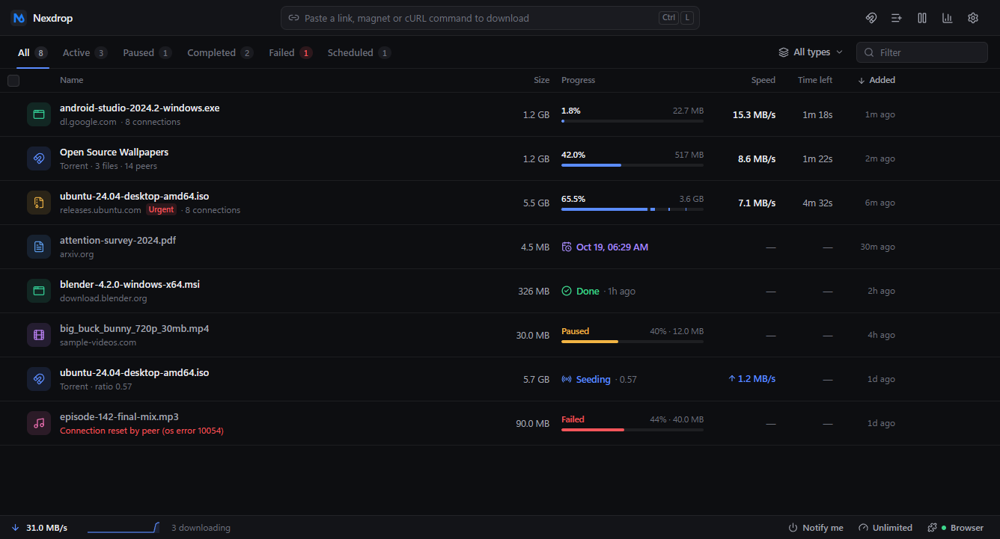
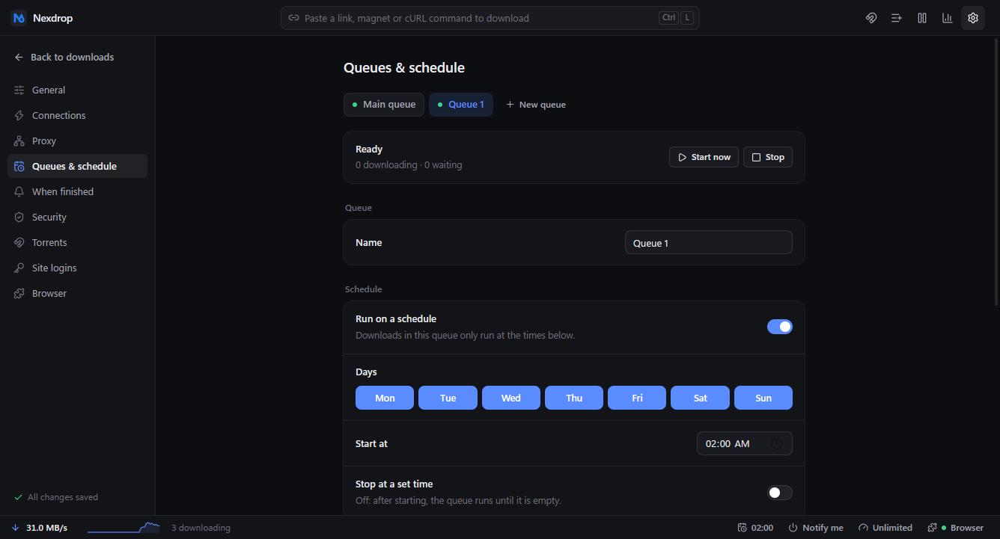
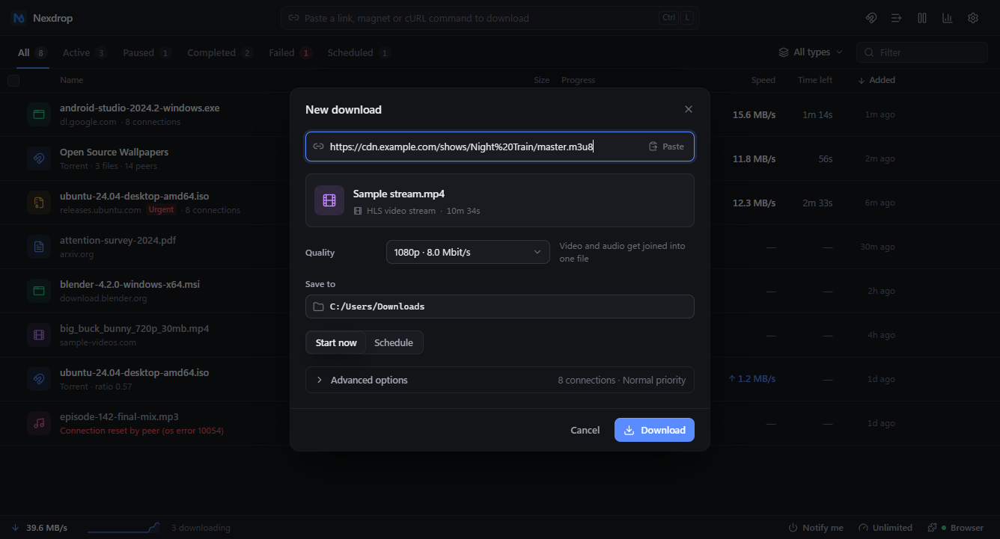
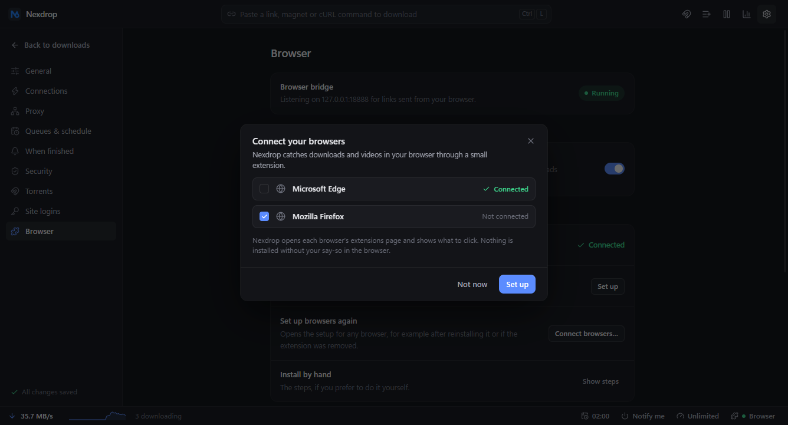

# Nexdrop

A fast, safe, modern download manager for Windows, built with Tauri 2 (Rust) and React.
Multi-connection acceleration, a real scheduler with queues, streaming-video downloads,
torrents, and a browser extension that catches downloads and videos like IDM does.



## What it does

**Fast and reliable**
- Splits a file over up to 32 connections, resumes after pauses, crashes and restarts, and
  keeps going through network drops (it waits out outages for up to ten minutes).
- Replaces stalled connections, refreshes expired signed links, falls back to one stream
  when a server can't do ranges, and checks free disk space first.
- Measured against a local network lab: `ENGINE_REPORT.md`.

**Queues and scheduler**
- Create named queues. Each has its own schedule (days, start, optional stop), limits
  (simultaneous downloads, shared speed cap), automatic retry, and a "when finished" action
  (quit, sleep, hibernate, shut down, lock, or run a program).
- Start now / Stop for any queue; downloads outside their schedule wait and say when they start.



**Streaming video (HLS and DASH)**
- Paste a `.m3u8` or `.mpd` link, pick a quality, and Nexdrop downloads the segments in
  parallel (AES-128 supported), resumes from the last whole segment, and joins separate video
  and audio into one playable `.mp4` without re-encoding.



**Browser integration (Chrome, Edge, Brave, Firefox)**
- Downloads your browser starts are handed to Nexdrop with your login cookies. Hold Alt on a
  link to keep the browser's own handling.
- A Download button over videos finds streams and video files the page loaded; the toolbar
  icon lists them.
- Setup is guided from inside the app and can be re-run any time (Settings > Browser).



**Also**: BitTorrent and magnet links with file selection, Mark of the Web on downloads,
checksum verification, saved site logins (encrypted), proxy support, system tray with
live status, start with Windows, and a single clean interface that stays out of the way.

## Install

Run `Nexdrop_<version>_x64-setup.exe`. It installs for the current user, needs no admin
rights, and Nexdrop offers to connect your browsers the first time it starts.

- **Firefox** gets a Mozilla-signed add-on (one click, permanent).
- **Chrome / Edge / Brave** load the extension from Nexdrop's folder; the setup window opens
  the extensions page and shows the folder. Developer mode has to be switched on by you.

## Build from source

Needs Node 20+, pnpm, Rust 1.85+ and the MSVC build tools (WebView2 ships with Windows).
Use a Git Bash shell on Windows so the native dependencies find the MSVC environment.

```bash
pnpm install
pnpm tauri dev                 # run it
bash scripts/release.sh        # build the installer into release/<version>/
```

`release/<version>/` gets `installer/` (the setup exe), `build/` (the app) and `extension/`
(per-browser extension packages).

## Tests

```bash
cd src-tauri && cargo test --release     # unit + integration tests
cargo test --release --test network_lab -- --ignored --nocapture --test-threads=1
```

End-to-end scripts in `scripts/` drive the real app and real browsers:
`e2e_release.py` (install, launch, tray, uninstall), `e2e_queues.py`, `e2e_streams.py`,
`e2e_bridge.py`, `e2e_extension.py` (Edge and Firefox), `e2e_browser_connect.py`,
`verify_streams.py` (decodes downloaded videos).

## Project map

```
src/                  React 19 + TypeScript + Tailwind interface
src-tauri/src/engine  download engine, queues, scheduler, streams (HLS/DASH), torrents
src-tauri/src/browsers.rs   browser detection and extension connection status
extensions/           browser extension (+ signed/ for the Mozilla-signed Firefox build)
scripts/              release, signing, packaging and end-to-end test scripts
docs/                 publishing guide and screenshots
```

More: `ROADMAP.md` (what's done and what's next), `ENGINE_REPORT.md` (speed and reliability
measurements), `docs/browser-extension-publishing.md` (signing and store publishing).

---

© 2026 AmirSRAD. All rights reserved. See [LICENSE](LICENSE).  
[amirsrad.ir](https://amirsrad.ir) · [github.com/amirsrad](https://github.com/amirsrad)
