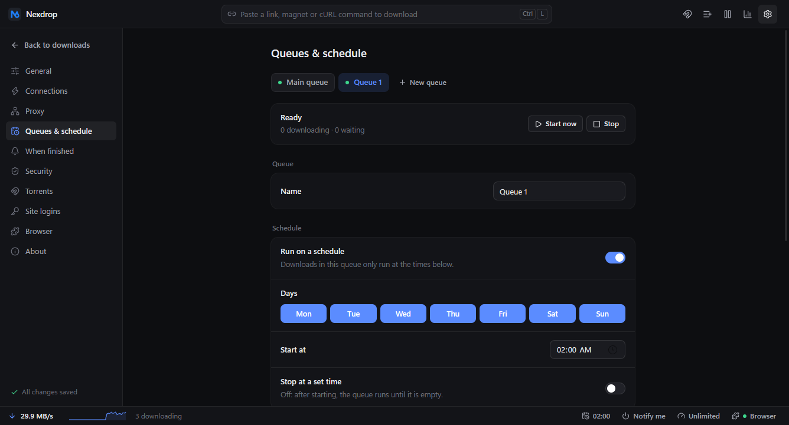
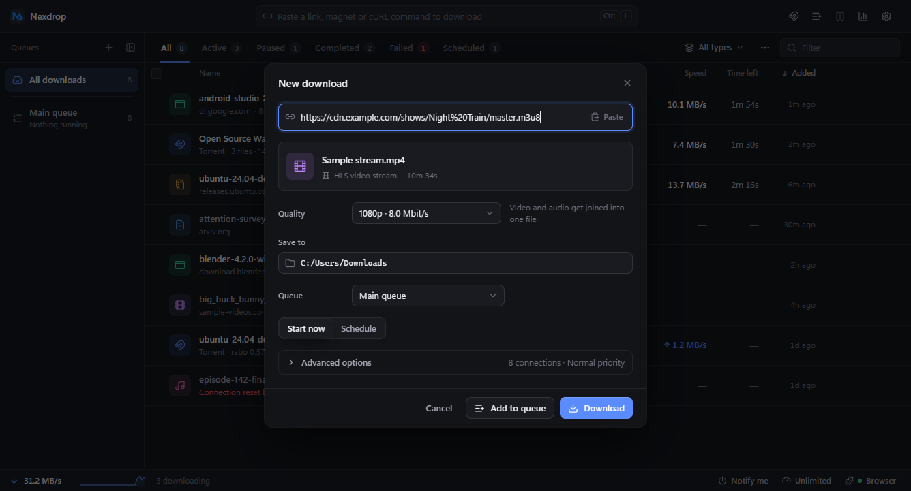
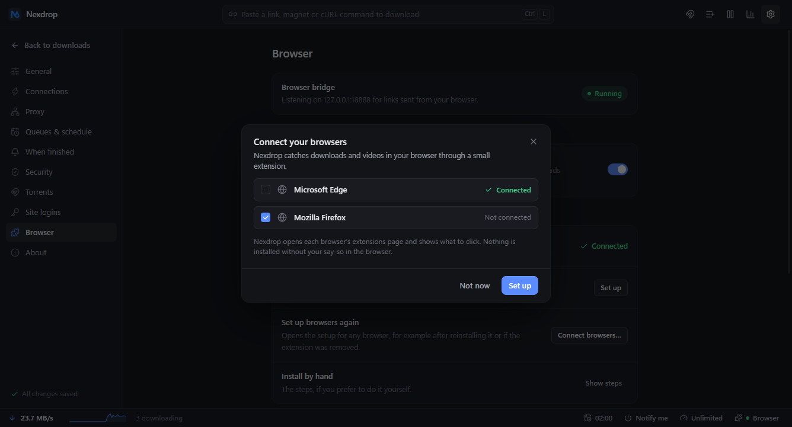

# Nexdrop

A fast, safe, modern download manager for Windows (macOS and Linux builds are in preview), built with
Tauri 2 (Rust) and React.
Multi-connection acceleration, a real scheduler with queues, streaming-video downloads,
torrents, and a browser extension that catches downloads and videos like IDM does.


## What it does

**Fast and reliable**
- Splits a file over up to 32 connections, resumes after pauses, crashes and restarts, and
  keeps going through network drops (it waits out outages for up to ten minutes).
- Replaces stalled connections, refreshes expired signed links, falls back to one stream
  when a server can't do ranges, and checks free disk space first.
- Measured against a local network lab: `ENGINE_REPORT.md`.

**Queues and scheduler**
- Create named queues. Each has its own schedule (days, start, optional stop), limits
  (simultaneous downloads, shared speed cap), automatic retry, and a "when finished" action
  (quit, sleep, hibernate, shut down, lock, or run a program).
- Start now / Stop for any queue; downloads outside their schedule wait and say when they start.
- Manage the line like IDM: **Download next**, move up / down / to the end (menu, or Alt+Up / Down / Home /
  End), **Download now** to start one beside a full queue, and drag downloads onto a queue in the side
  panel. Waiting downloads show "Next up" or "#3 in line"; the order survives restarts.
- In the New download panel, pick the queue and press **Add to queue** to line a download up without
  starting it; it runs when that queue starts.

**Bulk actions where you need them**
- The tab you are on offers its own button: **Clear completed** (Completed), **Retry all** (Failed),
  **Pause all** (Active), **Resume all** (Paused). The ⋯ menu next to the filters has all of them
  with counts, plus **Remove failed**. Clearing asks once and keeps files unless you say otherwise.

**Safe and in view**
- Queues are always on screen in a side panel: pick one to see its downloads, start or stop it in place.
- Every big download is checked against the server before it is kept ("Verifying…"); parts a server
  sent wrong are downloaded again. Each download has an Activity log and a "Copy diagnostics" button.
- Updates are signed and offered inside the app (Settings → About).

**Proxies**
- System proxy, direct, or a custom HTTP / SOCKS5 proxy with username and password, plus a
  "Test connection" button that shows the address websites will see.

**Several internet connections**
- Settings → Connections lists your active adapters (Ethernet, Wi-Fi, ...). Pick one, or several
  to share each download's connections across them; a dead adapter's connections move to the next.



**Links to a page with a Download button**
- Paste a link that turns out to be a web page (a file host where you must press a button) and
  press **Find the download**. Nexdrop opens the page in its own view, presses the download
  button (waiting out a countdown, skipping "Install our app" style buttons), and takes the file
  the page starts, with the page and cookies it needs. If the page needs a person (a check, an
  unusual button) the view opens for you to finish. It only runs when you press the button.

**Streaming video (HLS and DASH)**
- Paste a `.m3u8` or `.mpd` link, pick a quality, and Nexdrop downloads the segments in
  parallel (AES-128 supported), resumes from the last whole segment, and joins separate video
  and audio into one playable `.mp4` without re-encoding.



**Browser integration (Chrome, Edge, Brave, Firefox)**
- Downloads your browser starts are handed to Nexdrop with your login cookies. Hold Alt on a
  link to keep the browser's own handling.
- A Download button over videos finds streams and video files the page loaded; the toolbar
  icon lists them. It only shows while the pointer is on a real video (not background loops
  or short clips) and only when there is something to download; × hides it for the page.
- Right-click: "Download all N files on this page" (files only, other links tucked away in
  the list) and "Download N selected links". Links without a file name in their address are
  named from their text.
- Setup is guided from inside the app and can be re-run any time (Settings > Browser).



**Also**: BitTorrent and magnet links with file selection, Mark of the Web on downloads,
checksum verification, saved site logins (encrypted), file-exists and duplicate-link handling,
"Refresh link" for expired downloads, a per-server connection limit, system tray with live
status, start with Windows, and a single clean interface that stays out of the way.

## Light when idle

Nexdrop runs in the tray all day, so idle cost matters. Measured on Windows 11 with nothing
downloading (app plus its WebView2 processes, one minute; `scripts/measure_idle.ps1`):

| | CPU (one core) | Memory |
|---|---|---|
| Window open | about 0.4% | about 380 MB |
| Hidden in the tray | about 0.35% | about 135 MB |

In the tray the web view gives back its memory, the interface stops polling, and the
background checks read only the few rows they need instead of the whole download list.

## Install

Run `Nexdrop_<version>_x64-setup.exe`. It installs for the current user, needs no admin
rights, and Nexdrop offers to connect your browsers the first time it starts.

- **Updates** are offered inside the app (Settings → About) and are signed; installing always asks first.
- **macOS and Linux** preview builds (`.dmg`, `.AppImage`, `.deb`) are produced by the GitHub Actions
  build on every push. They compile and pass the unit tests but haven't been run on real machines
  yet, and some Windows-specific parts (start with Windows, browser detection) are not there.
- **Firefox** gets a Mozilla-signed add-on (one click, permanent).
- **Chrome / Edge / Brave** load the extension from Nexdrop's folder; the setup window opens
  the extensions page and shows the folder. Developer mode has to be switched on by you.

## Build from source

Needs Node 22, pnpm, Rust 1.90+ and the MSVC build tools (WebView2 ships with Windows).
Use a Git Bash shell on Windows so the native dependencies find the MSVC environment.

```bash
pnpm install
pnpm tauri dev                 # run it
bash scripts/release.sh        # build the installer into release/<version>/
```

`release.sh` signs the update with a key that stays on your machine (`.env.updater.key` and
`.env.updater`, git-ignored; create them with `pnpm tauri signer generate`, and put the public key in
`src-tauri/tauri.conf.json`). Without them it refuses to build, because an unsigned build can't be
offered as an update. `release/<version>/` gets `installer/` (the setup exe, its `.sig` and the
`latest.json` the updater reads; upload all three to the GitHub release), `build/` (the app) and
`extension/` (per-browser extension packages).

## Tests

```bash
cd src-tauri && cargo test --release     # unit + integration tests
cargo test --release --test network_lab -- --ignored --nocapture --test-threads=1
```

End-to-end scripts in `scripts/` drive the real app (close Nexdrop first; each backs up and restores
your database) and real browsers:

- App: `e2e_release.py` (install, launch, tray, uninstall), `e2e_queues.py`, `e2e_queue_order.py`
  (reordering, Download now), `e2e_bulk.py` (Add multiple), `e2e_features.py` (refresh link, replace,
  removing unfinished downloads, proxy test), `e2e_resolver.py` (Find the download),
  `e2e_many_links.py` (the browser's links window), `e2e_streams.py`, `e2e_bridge.py`,
  `e2e_browser_connect.py`.
- Browsers: `e2e_extension.py` (Edge and Firefox), `e2e_video_button.py`, `verify_signed_xpi.py`.
- Tools: `verify_streams.py` (decodes downloaded videos), `bench_vs_idm.py` (timing against an
  installed IDM on a local server), `measure_idle.ps1` (idle CPU and memory), `find_shifted.py` and
  `repair_parts.py` (find and repair files damaged by a CDN's slice bug, see `ENGINE_REPORT.md`).

## Project map

```
src/                  React 19 + TypeScript + Tailwind interface
src-tauri/src/engine  download engine, queues and their order, scheduler, streams (HLS/DASH), torrents
src-tauri/src/resolver.rs   "Find the download" (pages with a Download button)
src-tauri/src/network.rs    network adapters for multi-connection downloads
src-tauri/src/browsers.rs   browser detection and extension connection status
src-tauri/tests/      integration tests and the network lab (a server that misbehaves on purpose)
extensions/           browser extension (+ signed/ for the Mozilla-signed Firefox build)
scripts/              release, signing, packaging and end-to-end test scripts
docs/                 publishing guide and screenshots
```

More: `ROADMAP.md` (what's done and what's next), `ENGINE_REPORT.md` (speed and reliability
measurements and the engine's history), `docs/browser-extension-publishing.md` (signing and store
publishing), `BACKEND_REVIEW.md` (the October 2026 code review, kept as history).

---

© 2026 AmirSRAD. All rights reserved. See [LICENSE](LICENSE).  
[amirsrad.ir](https://amirsrad.ir) · [github.com/amirsrad](https://github.com/amirsrad)
